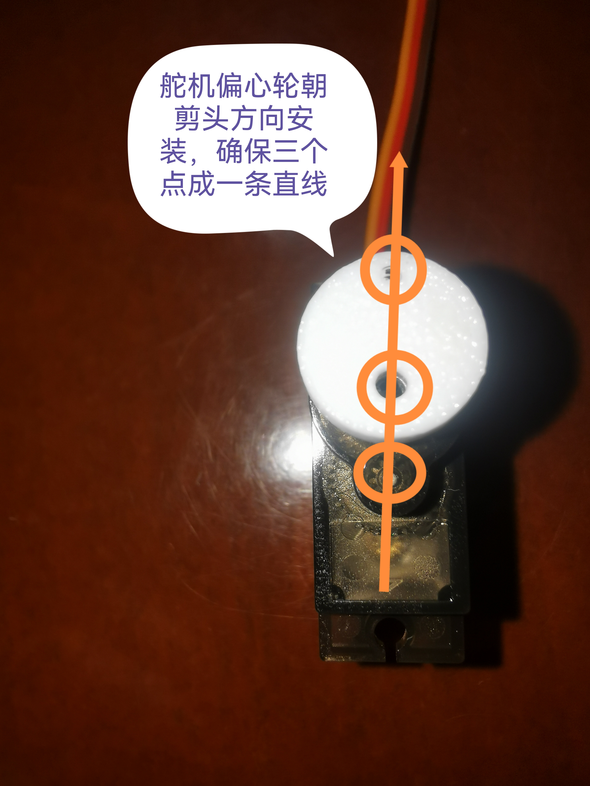

# 03 · 装配与验收测试

## 1. 打样与物料

- 工程：`hardware/蝌蚪RS485飞达控制板.epro2`（立创EDA 原生工程，原理图 + PCB 一体，直接用立创EDA 打开导出 Gerber 下单）。
- 物料：`hardware/BOM_蝌蚪RS485飞达控制板_电路板单板.xlsx`（立创EDA 导出，16 项 / 18 只，含立创编号，可一键配单）。
- 结构件：`hardware/蝌蚪飞达3D打印件.3mf`（主体 + 盖板 + 拨杆/偏心轮，直接切片打印）。
- 电源结构：整板 **5V 单电源**（集线板/槽位输入），U1 AMS1117-3.3 产生 3V3 供 MCU 与收发器；**舵机直接吃 5V**，不经过 LDO。
- 关键器件注意：

| 器件 | 位号 | 注意点 |
|---|---|---|
| STC8H8K64U-45I-SOP16 | U4 | 1.27mm 脚距，手工可焊；SOP16 与老款 STC8 引脚不兼容，别拿错芯片 |
| MAX3078EESA+T | U28 | SOIC-8，**3.3V 供电**，pin6=A / pin7=B；不要用 5V 收发器代换 |
| AMS1117-3.3 | U1 | SOT-223，5V→3.3V；大面积铺铜散热，输入输出各留 10µF/1µF |
| 04F414000 板对板连接器 | U2 | SMD 4P 槽位连接器，回流焊；贴装前核对与集线板插座的针位方向 |
| PZ254V-11-03P 3P 排针 | H1 | 舵机接口（PWM / 5V / GND），焊前排线方向别反 |
| LAIL-PZ2.54-4P-L 4P 卧式座 | H2 | ISP/调试口（GND / TXD / RXD / 3V3），脚序按板上丝印 |
| TC-6615 轻触开关 | SW1 | 4 脚贴片式，短按 2mm / 长按连续送料 |
| LTST-C191KSKT 黄色 LED | LED1 | 0603；限流电阻 R1 现为 10k，亮度偏低，室内可用即可，想要更亮换 1k |
| 220µF 电解 C3 | C3 | 舵机/电源储能，注意极性与耐压，别装反 |
| 2kΩ R76 | R76 | DE//RE 下拉，上电默认接收态，**不可省** |
| 1kΩ R2/R84/R3 | — | RO 串阻与限流，按 BOM 位置装，不要互相调换 |

> 与旧电机方案相比，板上**不再有** DRV8838 驱动、编码器接口、槽型光电、33µH 电感与续流二极管，BOM 里找不到这些器件是正常的。

## 2. 焊接与装配顺序

1. 先焊 0603 无源件（C1/C2/C4/C30、R1/R2/R3/R76）与 LED1，注意 LED 阴极方向、C3（220µF）电解极性。
2. 再焊 SOIC/SOP：先 U28（MAX3078E，认准 pin1 圆点）再 U4（STC8H8K64U，第 1 脚对齐丝印）。
3. U1（AMS1117-3.3）放最后焊。也可以先空着，从 U2 槽位送 5V 量母线 4.75–5.25V、确认无短路后再补焊，避免稳压异常时连带烧 MCU。
4. 上电（**先不插舵机**）：量 3V3 = 3.2–3.4V；5V 侧静态电流 < 30mA。
5. 焊插件与连接器：H1（舵机 3P 排针）、H2（4P 卧式座）、SW1；U2（04F414000 槽位连接器）用热风/回流焊，注意与集线板插座的方向。
6. 装舵机：先把它固定到打印主体上再接 H1，线序 **橙/黄=PWM → 红=5V → 棕/黑=GND**，插反会直接烧舵机；舵机 VCC 就近补 100µF + 0.1µF。
7. 打印结构件（`hardware/蝌蚪飞达3D打印件.3mf`）：主体 + 料道盖板 + 拨杆；偏心轮**必须等固件烧好、舵机回 0° 后再装**，见 §2.1。
8. 首次上电前用万用表确认 5V–GND、3V3–GND 均无短路。

### 2.1 舵机与偏心轮安装（顺序不能颠倒）

**必须先把舵机调到 0° 起始位，再装偏心轮**，否则拨杆的送料行程会整体偏移，出现推料不到位或顶死料带。

1. 飞达控制板烧录固件后上电。
2. 手动按两下送料键（SW1），让舵机自检回到 0° 位置后停止动作。
3. 保持舵机停在 0°，此时把偏心轮按图片所示的位置装到舵机输出轴上。
4. 确认图片上**三个点连成一条直线**，再拧紧锁紧螺钉。



> 三点一线即舵机 0° 时拨杆的机械零位；装错位置后不要靠改固件脉冲去补偿，重新对位即可。

## 3. 机械与料道要点

| 项 | 要求 |
|---|---|
| 料道宽度 | 8mm 载带 + 0.3mm 间隙；上下盖板倒角防卡带 |
| 驱动方式 | SG90/MG90S 舵机 + 偏心轮拨杆（单向推料）：90° = 2mm，180° = 4mm |
| 撕带 | 单向棘轮撕带轮，回程 180° 转 1 齿 = 撕 4mm 盖带；首次上料先预撕 3–5 颗 |
| 偏心轮零位 | 舵机 0° 时三点一线（见 §2.1），装错会让整条送料行程偏移 |
| 盖带余量 | 每两个 2mm 步撕一次 4mm，取料口处盖带余量始终 ≥ 2mm |
| 舵机线 | 与 A/B 分开走线，避免并行；线束避开拨杆与撕带轮的运动范围 |
| 槽位安装 | 与官方飞达相同的插入深度与锁扣位置；取料口相对槽位坐标固定 |

## 4. 验收测试（逐项打勾）

> 除特别说明，命令均在 `lumenpnp-feeder` 目录执行，`COM7`、`0x05` 按实际替换。

### T1 电源

| 步骤 | 通过标准 |
|---|---|
| 5V 输入空载 | 5V = 4.75–5.25V，3V3 = 3.2–3.4V；纹波 < 100mVpp（示波器 20MHz 带宽） |
| 舵机堵转 2s | 5V 谷值跌落 < 0.5V；U1（AMS1117）无过热（< 60℃） |
| 5V 从 4.5V 拉到 5.5V | 3V3 稳定；飞达不复位 |

### T2 烧录与启动

| 步骤 | 通过标准 |
|---|---|
| STC-ISP 烧录 | 校验通过；冷启动后 `version` 返回 1 |
| 掉电重启 10 次 | 地址不丢（`diag` 与 `address` 一致） |

### T3 通信

| 步骤 | 通过标准 |
|---|---|
| `scan --program 0x05` | 1s 内发现 UUID 并编址成功 |
| `init` | status=0x00，UUID 与扫描一致 |
| 连续 10 万帧 `status` 轮询 | 无错帧、无丢包（脚本见下） |
| A/B 交换 | 无应答但不损坏（换回即恢复） |

```powershell
# 10 万帧压测（真机；先跑 --sim 验证工具本身）
python host\stress_test.py --sim --count 20000
python host\stress_test.py --port COM7 --addr 0x05 --count 100000
```

### T4 送料精度（开环，无编码器反馈）

| 步骤 | 通过标准 |
|---|---|
| `feed --mm 2 --wait` 连续 50 次 | 每次 status=0x00；料带累计位移 100mm ±2mm |
| `feed --mm 4 --wait` 连续 25 次 | 每次回程撕带 1 齿；累计 100mm ±2mm |
| 单次重复定位（激光/视觉测） | ±0.3mm 内（拨杆机械间隙决定，非软件可调） |
| `back --mm 4` | status=0x00，舵机回 0°；单向机构不实际退带（预期行为） |

### T5 步距与撕带

| 步骤 | 通过标准 |
|---|---|
| 长按 SW1 走 5 个 2mm 步 | 料带前进 10mm ±0.3mm |
| 连续 20 步 | 累计 40mm ±1mm，无累积错位 |
| 每 2 步后的撕带 | 撕带轮转 1 齿；取料口盖带已撕开、元件完全露出 |
| 不合格时 | 调 `config.h` 的 `SERVO_*` 脉宽/延时后重编译，不在 EEPROM 里改 |

### T6 异常与卡带

| 步骤 | 通过标准 |
|---|---|
| 用 `raw` 发 tenths=0 的 0x04 帧 | 立即返回 0x02（COULDNT_REACH），舵机不动（CLI 的 `feed --mm 0` 在本地就被拦下，测不到固件这条分支） |
| 人为卡住料带后送料 | 开环无堵转检测，表现为送料不到位，需人工清卡（已知限制） |
| 长按 SW1 20 步后松开 | 每步 2mm，松开即停，无越位 |

### T7 Identify 与编址

| 步骤 | 通过标准 |
|---|---|
| `identify --uuid <扫描值>` | 目标飞达闪 3 次，其他飞达不动 |
| `program --uuid <值> --slot 0x0A` | status=0x00；`address --uuid` 返回 0x0A |
| 两台新飞达同时上电后 `scan` | 能依次发现两台（0xC3 错峰生效） |

### T8 多机总线

| 步骤 | 通过标准 |
|---|---|
| 挂 5 台，地址 1–5，逐一 `init`+`feed` | 无串台（只有目标飞达动作） |
| 25 台混跑 1 小时 | 无总线死锁；单台 FAIL 不影响其他 |
| 与官方 Photon 飞达混插 | 双方都能被 OpenPnP Search 发现并送料 |

### T9 OpenPnP 整机

| 步骤 | 通过标准 |
|---|---|
| Global Config → Search | 已编址飞达全部 FOUND |
| Program Feeder Slots 向导 | 新飞达编址成功 |
| Feeder 页 Feed | 无 FeedFailureException；料带前进一个 partPitch |
| 跑 100 个贴片 Job | 无漏料/无送料失败 |

### T10 环境与可靠性

| 步骤 | 通过标准 |
|---|---|
| 连续送料 2 万次 | 无 FAIL 堆积；检查棘轮磨损与拨杆回差 |
| 0–40℃ | 57600 通信无错帧 |
| 接触放电 ±4kV（A/B、外壳） | 不复位、不损坏；通信自恢复 |
| 总线 A/B 短路 1s 后恢复 | 不损坏；恢复后正常通信 |

## 5. 测试记录模板

```
测试日期：        样机编号：        固件版本：
T1 电源      □  备注：
T2 烧录      □  备注：
T3 通信      □  备注：
T4 精度      □  备注：实测重复误差 ____ mm
T5 步距      □  备注：10 步实测 ____ mm
T6 异常      □  备注：
T7 编址      □  备注：
T8 多机      □  备注：挂载数量 ____
T9 整机      □  备注：
T10 环境     □  备注：
结论：□ 通过   □ 有条件通过（问题：          ）   □ 不通过
```
